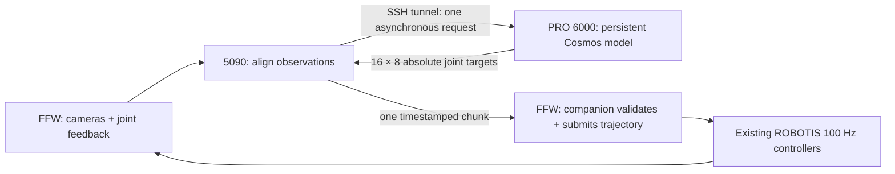

# Three-machine Cosmos inference pipeline

Updated 2026-11-04. All software below is implemented and tested locally on PRO 6000.
Nothing has been copied to, installed on, restarted, or commanded on 3sp5090 or FFW.
The reference hardware profile deliberately remains non-executable.



There are three small processes: model server, gateway, companion. Existing ROBOTIS
bringup, sensors, controller manager, and motor drivers remain responsible for the robot.
No second robot driver or IK layer is installed on the 5090.

## Start the model server on PRO 6000

Use a free GPU explicitly. This example uses the verified official base image and
Edge step 20000, preserving the saved checkpoint contract and source-matched adapter:

```bash
python3 scripts/cosmos3.py serve \
  --variant edge --step 20000 --gpu 5 --image base \
  --tokenizer assets/nvidia--Cosmos3-Edge-344d602b128d1bbdacb43b08d0a3626f46343e29 \
  --vae assets/Wan-AI--Wan2.2-TI2V-5B-921dbaf3f1674a56f47e83fb80a34bac8a8f203e/Wan2.2_VAE.pth \
  --warmup-observation inputs/recorded_observation.npz \
  --warmup-runs 3 --guidance-interval 960 1001
```

The model loads once and warms before listening. The launcher creates
`.runtime/inference.token` with restrictive permissions without printing it. The API
is exposed only on PRO 6000's `127.0.0.1:8008`; robot networking/devices and SSH keys
are not mounted in the model container. To use Nano, select its matching tokenizer
and `--variant nano`, and omit the Edge guidance interval.

Test the live service locally without any robot connection:

```bash
python3 scripts/gateway.py replay \
  --replay-observation inputs/recorded_observation.npz \
  --requests 5 --output outputs/local-http-replay-001
```

Saved replies retain the recording's original timestamp. Replay is for inspecting
outputs and measuring latency; old predictions are not suitable for live execution.

## Prepare the two small deployment folders here

```bash
python3 scripts/package_gateway.py --output outputs/gateway_bundle
python3 scripts/package_ffw.py --output outputs/ffw_bundle
```

Both folders are standalone and have checksum manifests. No command transfers files.
The gateway includes the pinned SDK and five licensed message definitions; FFW reuses
its installed `robotis/ai-worker:2.2.8` ROS image. Keep the model, weights, tokenizer,
VAE, recordings, and all large framework images on PRO 6000. Each generated folder's
README and `.env.example` describe its settings. Preserve the default preview mode.

## Later deployment and startup order

These commands are instructions for a later authorized deployment, not actions already
performed. The SSH destination for PRO 6000 is still an operator-supplied value.

1. Copy the gateway folder to 5090 and the companion folder to FFW. Supply the same
   camera-verified robot profile to both. Separately copy the server token to 5090 as
   `inference.token` with mode 600. FFW does not need the token or model assets.
2. Start the warmed PRO 6000 model service. On 5090, keep this SSH tunnel running:

   ```bash
   ssh -N -o ExitOnForwardFailure=yes -o ServerAliveInterval=15 -o ServerAliveCountMax=3 \
     -L 127.0.0.1:8008:127.0.0.1:8008 <PRO6000-SSH-alias>
   ```

3. On FFW, set FFW_INITIAL_POSITIONS to the actual YAML selected by ROBOTIS bringup,
   then `docker compose build` and `docker compose up` from its bundle. Default is
   preview. Start this companion before the externally managed homing sequence so
   it can witness fresh success for all four homing actions. It never starts homing.
4. On 5090, create `logs/`, configure `.env` with your UID/GID, instruction, profile,
   token path, and a new run ID, then `docker compose build` and `docker compose up`
   from its bundle. Default is preview. Missing/unknown camera transforms stop startup.
5. Finish ROBOTIS homing and settling. The companion captures measured left arm,
   left gripper, head, and elevator once. The gateway begins requests when FFW reports
   readiness. Preview exercises inference, timing, and local acceptance with zero
   physical trajectory publishers. Tracking/motor response still needs a live check.
6. Only after commissioning, select execute mode in both folders with a profile whose
   status is `verified_on_robot` and execution_enabled is true. This does not bypass
   homing, controller health/ownership, bounds, velocity, freshness, or watchdog gates.

For an initial observation-only inspection in the gateway bundle, use:

```bash
docker compose run --rm gateway inspect \
  --profile /config/profile.json \
  --messages-dir /opt/cosmos_gateway/messages \
  --output /output/inspect-001 --duration 10
```

Inspect creates no publishers and does not call the model. Its diagnostics report
raw dimensions and timestamps; an operator still needs to compare orientation and
field of view with the training preparation. This compose configuration still requires
the mounted token file to exist even though inspect does not read it.

## Chunk timing and holds

The policy returns 16 waypoints at 50 ms spacing: 0.8 seconds measured from the original
FFW observation, including time spent in transmission and inference. PRO 6000 echoes
that timestamp. The 5090 forwards the whole chunk once; FFW discards elapsed rows and
submits future points to the existing JointTrajectoryController for interpolation.
The 5090 never publishes physical joint commands.

One inference request is in flight. Before the active forecast expires, the gateway
uses measured request latency plus 100 ms margin to request the newest observations.
A new chunk replaces the remaining tail. Late responses, old session IDs, and fully
expired chunks are rejected rather than retimed. If a chunk ends first, FFW holds the
latest measured right pose while passive targets remain at the post-homing snapshot.
A fresh valid chunk may resume a temporarily starved session.

Rehoming invalidates the session and removes its old holds. Explicit stop or a fault
closes the gate. Shutdown announces a new stopped epoch. A new companion session and
new homing sequence are required to restart. Details and stop limitations are in the
[FFW companion documentation](../deploy/ffw/README.md).

## Local measurements and checks

RTX PRO 6000 GPU 5, step 20000, seed 0, four sampling steps, guidance 3, shift 5.
Three warmup calls precede five HTTP recorded-input requests for each variant:

| Variant | Loaded once (s) | Warm HTTP median (s) | Warm HTTP max (s) |
| --- | ---: | ---: | ---: |
| Edge | 18.09 | 0.231 | 0.293 |
| Nano | 48.98 | 0.401 | 0.440 |

Reports: `outputs/edge-network-replay/report.json` and
`outputs/nano-network-replay/report.json`. Both return finite 16×8 absolute positions
and preserve source timestamps. These are local HTTP timings, excluding real SSH/LAN,
camera alignment and robot response; five requests establish a functional smoke test,
not a sustained jitter/quality benchmark. With stationary feedback at the recorded pose
and the worst measured request latency, the actual Edge reply passed the FFW bounds/velocity
gate with nine future points remaining. Nano was rejected because its gripper prediction
included -0.0081 rad, below the reference zero lower limit. This is model-output evidence,
not a transport error; no clipping or gripper remapping is applied. See each replay folder
for `ffw_validation.json`. Edge has more timing margin and is the initial
runbook example. For serial requests, roughly two round-trip latencies plus margin must
fit within 0.8 s to avoid holds; measured Nano is too close/slow for that guarantee.

CPU integration tests exercise raw synthetic cameras and measured joints through the
actual HTTP service and gateway into the FFW chunk executor. Other cases cover stale
inputs/status, timestamp skew, old epochs, starvation, duplicates, velocity/position
limits, homing, holds, ownership loss, authentication, one model thread, and portable
bundles. The unchanged SDK also passes actual local Zenoh pub/sub with bundled schemas, including
inside the built Python-only gateway image with a read-only filesystem and network disabled;
this is a loopback check, not validation against the robot's router.

## Information still needed for physical commissioning

- Observed raw dimensions and the correct live-to-training rotation for each camera.
  The reference configuration's rotation is evidence to compare, not a value to guess.
- Actual selected home YAML, installed limits, position-controller claims, and exclusive
  command ownership on FFW's installed 2.2.8 stack. No robot services were active during
  the earlier read-only inspection. Do not use the alternate head target 0.78 until its
  mismatch with the reference 0.6951 upper limit is resolved.
- The 5090-to-PRO 6000 SSH destination and real network reachability/jitter.
- Live preview acceptance followed by supervised initial motion, tracking, shutdown,
  and starvation checks with the robot's independent stop available.

No hardware values above have been filled in by assumption. The remaining work is
commissioning the installed robot and verifying its observations and motion behavior.
