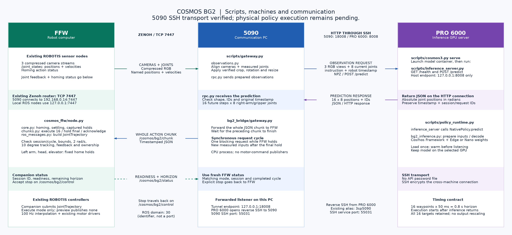
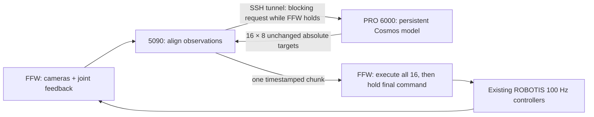

# Three-machine Cosmos inference pipeline

Updated 2026-11-04. All software below is implemented and tested locally on PRO 6000.
Gateway software is installed and tested on 3sp5090 at the user's request. FFW remains
unchanged; no robot services or motion commands have been started by this setup.
The reference hardware profile deliberately remains non-executable.
See the [5090 setup record](5090_setup_20261104.md) for the installed location and checks.
The [FFW startup review](ffw_startup_review_20261104.md) maps the official follower
bringup to our companion, homing, camera checks and inference startup.

Rendered diagram: [PNG](diagrams/three_machine_pipeline.png),
[SVG for zooming/printing](diagrams/three_machine_pipeline.svg),
[editable Graphviz source](diagrams/three_machine_pipeline.dot).



Regenerate the images with the local Graphviz `dot` command:

```bash
dot -Tsvg docs/diagrams/three_machine_pipeline.dot -o docs/diagrams/three_machine_pipeline.svg
dot -Tpng -Gdpi=110 docs/diagrams/three_machine_pipeline.dot -o docs/diagrams/three_machine_pipeline.png
```



There are three small processes: model server, gateway, companion. Existing ROBOTIS
bringup, sensors, controller manager, and motor drivers remain responsible for the robot.
No second robot driver or IK layer is installed on the 5090.

For the camera/joint-state check without policy commands, use the
[observation-only commands](observation_only_bringup.md). That pass disables homing
and does not start our companion.

## Start the model server on PRO 6000

Use a free GPU explicitly. This example uses the verified official base image and
Edge step 20000, preserving the saved checkpoint contract and source-matched adapter:

```bash
python3 scripts/cosmos3.py serve \
  --variant edge --step 20000 --gpu 5 --image base \
  --tokenizer assets/nvidia--Cosmos3-Edge-344d602b128d1bbdacb43b08d0a3626f46343e29 \
  --vae assets/Wan-AI--Wan2.2-TI2V-5B-921dbaf3f1674a56f47e83fb80a34bac8a8f203e/Wan2.2_VAE.pth \
  --warmup-observation inputs/recorded_observation.npz \
  --warmup-runs 3 --guidance-interval 960 1001
```

The model loads once and warms before listening. There is no API password check or
credential file. The API
is exposed only on PRO 6000's `127.0.0.1:8008`; robot networking/devices and SSH keys
are not mounted in the model container. To use Nano, select its matching tokenizer
and `--variant nano`, and omit the Edge guidance interval.

Test the live service locally without any robot connection:

```bash
python3 scripts/gateway.py replay \
  --replay-observation inputs/recorded_observation.npz \
  --requests 5 --output outputs/local-http-replay-001
```

Saved replies retain the recording's original timestamp. Replay is for inspecting
outputs and measuring latency; old predictions are not suitable for live execution.

## Prepare the two small deployment folders here

```bash
python3 scripts/package_gateway.py --output transfer/5090
python3 scripts/package_ffw.py --output transfer/ffw
```

Both folders are standalone and have checksum manifests. No command transfers files.
The gateway includes the pinned SDK and five licensed message definitions; FFW runs a separate companion using
its installed `robotis/ai-worker:2.2.8` ROS image with read-only code mounts; no FFW image
build or package installation is needed. Keep the model, weights, tokenizer,
VAE, recordings, and all large framework images on PRO 6000. Each generated folder's
README and `.env.example` describe its settings. Preserve the default preview mode.

## Later deployment and startup order

The 5090 software setup is authorized. FFW deployment and robot execution remain future
work. The existing PRO 6000 → `3sp5090` SSH alias is used to avoid a second SSH setup.

1. Copy the gateway folder to 5090 and, only when authorized, the companion folder to
   FFW. Supply the same camera-verified robot profile to both. Model assets stay on
   PRO 6000. No API password file is needed.
2. Start the warmed PRO 6000 model service. In another terminal **on PRO 6000**, keep
   this reverse SSH tunnel running using the already-working `3sp5090` alias:

   ```bash
   ssh -N -T -o ExitOnForwardFailure=yes -o ServerAliveInterval=15 -o ServerAliveCountMax=3 \
     -R 127.0.0.1:18008:127.0.0.1:8008 3sp5090
   ```

   The SSH connection is initiated by PRO 6000 to the 5090's existing SSH service
   (configured port 55031). The gateway calls `http://127.0.0.1:18008` on the
   5090; SSH carries that connection back to PRO 6000's local model service. The
   forwarded listener is bound only to 127.0.0.1. No extra SSH keys need to be copied.

3. On FFW, set FFW_INITIAL_POSITIONS to the actual YAML selected by ROBOTIS bringup,
   then `docker compose up --no-build --pull never` from its generated bundle. It
   reuses the installed image in a separate companion container, with read-only code
   and configuration; no image build, install, or restart of `ai_worker`. Default is
   preview. Start this companion before the externally managed homing sequence so
   it can witness fresh success for all four homing actions. It never starts homing.
4. On 5090, create `logs/`, configure `.env` with your UID/GID, instruction, profile,
   and a new run ID, then `docker compose build` and `docker compose up`
   from its bundle. Default is preview. Missing/unknown camera transforms stop startup.
5. Finish ROBOTIS homing and settling. The companion captures measured left arm,
   left gripper, head, and elevator once. The gateway begins requests when FFW reports
   readiness. Preview exercises inference, timing, and local acceptance with zero
   physical trajectory publishers. Tracking/motor response still needs a live check.
6. Only after commissioning, select execute mode in both folders with a profile whose
   status is `verified_on_robot` and execution_enabled is true. This does not bypass
   homing, controller health/ownership, bounds, velocity, freshness, or watchdog gates.

For an initial observation-only inspection in the gateway bundle, use:

```bash
docker compose run --rm gateway inspect \
  --profile /config/profile.json \
  --messages-dir /opt/cosmos_gateway/messages \
  --output /output/inspect-001 --duration 10
```

Inspect creates no publishers and does not call the model. Its diagnostics report
raw dimensions and timestamps; an operator still needs to compare orientation and
field of view with the training preparation. Inspect requires no API password or model
service and creates no policy publishers.

## Synchronous execution and stops

The agreed contract is **hold → fresh measured observation → inference → execute all 16
points → hold the final command → request again**. See the
[synchronous execution contract](synchronous_execution_20261104.md) for code, protocol,
thresholds and restart behavior.

Every target is preserved, with 50 ms spacing from execution start. Inference time does
not consume the execution horizon. The gateway waits for FFW's completed cycle and final
hold before collecting the next joint/camera sample. Active chunks are never replaced.

Angular command/measured velocity above 2 rad/s or angular tracking error above 10 degrees
faults the session and attempts a measured-position stop hold. No scaling, clipping or
new linear elevator threshold is applied. A software hold cannot be guaranteed without
usable feedback/controller ownership. Initial homing and 500 ms settling remain required
for each companion session; there is no homing between chunks.

## Validation and deployment state

90 local CPU tests run: 89 pass and the optional SDK test skips in the default host
environment. They cover the synchronous lifecycle, unchanged target arrays, delayed
inference, fresh post-hold inputs, limit-triggered terminal stops, TCP drop/refusal,
HTTP timeout, homing, controller gates and standalone bundles. Physical actuation and
network-failure stopping remain untested.

Earlier warmed recorded-input HTTP timings were Edge 0.231 s median / 0.293 s maximum,
Nano 0.401 / 0.440 s over five calls each. Those are historical local model timings,
not synchronous full-cycle throughput or live robot benchmarks. Earlier reports describing
skipped points or async trajectory acceptance do not validate this revised executor.

The installed 5090 copy predates this synchronous revision until explicitly updated;
new local bundles do not update remote code/images. FFW has not received this companion.
The initial observation-only commands remain valid and send no policy commands.

## Remaining commissioning inputs

- Verify camera orientation and field of view against training, in addition to observed
  raw dimensions (head 672×376, each wrist 424×240).
- Resolve the unchanged SNUPI head target 0.78 versus installed upper limit 0.6951.
- Verify actual controller claims, command ownership, calibration and supervised stopping.
- Supply the actual instruction and verified deployment profile; execution remains disabled.
- Update 5090 and FFW from matching synchronous bundles before preview or execution.
