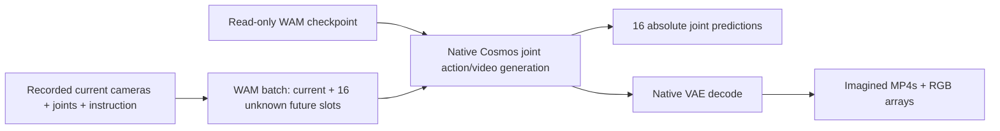

# Offline BG2 WAM inference on PRO 6000

This command generates one complete action chunk and its imagined video from a recorded
current observation. Everything runs on PRO 6000. It opens no server or tunnel and has no
connection to 5090 or FFW. The existing hardware pipeline is unchanged.

For the persistent server used by the gateway, see [WAM server setup](wam_server.md).

The sequence is synchronous: load current observation → jointly generate actions/video →
decode video → save results → exit. There is no RTC, prefetch, background inference or robot
execution. If connected to hardware in future, the agreed sequence remains: execute all
16 points, hold the final command, then capture fresh observations and request another chunk.



## 1. Select a free GPU

Run on **PRO 6000**, in the repository:

```bash
cd /home/sangjunpark/Documents/cosmos_inference_bg2
nvidia-smi
```

Choose an idle physical GPU index. The examples use GPU 4; replace it if occupied. The WAM
launcher checks immediately before launch and refuses occupied GPUs. It never stops other
workloads. Use the existing `cosmos-framework:robotescape-b98934e` Docker image; no additional
model weights or packages are needed on this machine.

## 2. Choose the current observation

The existing `inputs/recorded_observation.npz` contains only current images, current measured
joints, joint names, a timestamp and instruction. You can substitute another observation
archive in the same format. Input images must already use the training crops and sizes:

| Input | RGB shape | Composite location |
|---|---|---|
| `head` | 384 × 512 × 3 | Top |
| `wrist_left` | 256 × 256 × 3 | Bottom left |
| `wrist` | 256 × 256 × 3 | Bottom right |

`joint_position` is eight absolute measured coordinates in radians, in the order recorded
in the archive's `joint_names`: seven right-arm joints followed by `gripper_r_joint1`.
The strict archive loader rejects future labels and unknown fields. `--instruction` overrides
the archive instruction without changing the input file. Use an instruction appropriate to
the recorded scene; the commands below show where to put it.

## 3. Run Edge or Nano

**Edge:**

```bash
python3 scripts/cosmos3.py wam \
  --variant edge --step 20000 --gpu 4 \
  --observation inputs/recorded_observation.npz \
  --tokenizer assets/nvidia--Cosmos3-Edge-344d602b128d1bbdacb43b08d0a3626f46343e29 \
  --vae assets/Wan-AI--Wan2.2-TI2V-5B-921dbaf3f1674a56f47e83fb80a34bac8a8f203e/Wan2.2_VAE.pth \
  --instruction "Pick up the police car and place it on the top-right picture"
```

**Nano:**

```bash
python3 scripts/cosmos3.py wam \
  --variant nano --step 20000 --gpu 4 \
  --observation inputs/recorded_observation.npz \
  --tokenizer assets/nvidia--Cosmos3-Nano-e59a53c25979a090fa8706c9acc0c254a6e89b92 \
  --vae assets/Wan-AI--Wan2.2-TI2V-5B-921dbaf3f1674a56f47e83fb80a34bac8a8f203e/Wan2.2_VAE.pth \
  --instruction "Pick up the police car and place it on the top-right picture"
```

Both default to the checkpoint root:

```text
/mnt/sata1/RobotEscapeCkpt/cosmos3_wam_room20k_20261105/{edge,nano}/020000/
```

The launcher validates the new `READY.json`, `TRANSFER_VERIFIED.json`, shard inventory and
sizes, saved WAM model configuration, and `connection_test/experiment_contract.json`.
Add `--sha256` to also rehash every shard; this reads many GB. Empty distributed rank shards
listed by the export are valid and are preserved.

Useful flags:

- `--check`: validate checkpoint contracts and asset paths, without starting Docker or a GPU.
- `--dry-run`: print the exact Docker command without running it.
- `--output outputs/my-wam-run`: choose a **new** results directory under this repo's `outputs/`.
- `--seed 0 --steps 4 --guidance 3 --shift 5`: explicit sampling settings.
- `--guidance-interval 960 1001`: Edge's default guidance window. Nano defaults to all steps.
  `--guidance-all-steps` explicitly selects all steps for either tier. These are configurable
  inference settings, not values established by the fine-tuning checkpoint.
- `--checkpoint-root /path/to/root --experiment-contract /path/to/experiment_contract.json`:
  use another compatible WAM export. Nothing is written beside these files.

## 4. Open the saved results

The command prints a fresh `outputs/wam-<tier>-020000-<time>-<id>/` directory. It contains:

| File | Contents |
|---|---|
| `imagined_future.mp4` | The 16 generated future composite frames, 20 fps, 0.8 s |
| `rollout_full.mp4` | Reconstructed current frame + 16 future frames, 20 fps, 0.85 s playback |
| `imagined_head.mp4` | Future head-camera crop |
| `imagined_wrist_left.mp4` / `imagined_wrist_right.mp4` | Future wrist-camera crops |
| `input_composite.png` | Exact current RGB image supplied to Cosmos |
| `context_reconstruction.png` | Current frame reconstructed through the VAE |
| `imagined_last_frame.png` | Final imagined composite frame |
| `joint_positions.npy` / `.json` | 16 × 8 absolute joint predictions; offsets 50–800 ms |
| `normalized_actions.npy` | Native 17 × 8 output including conditioned current state |
| `vision_latent.npy` / `decoded_rollout.npy` | Generated latent and decoded 17-frame RGB array |
| `launch.json` / `request.json` | Checkpoint/input hashes, GPU selection, masks, prompt, sampling and provenance |
| `outputs.json` / `rollout.json` | Timings, memory use, dimensions and frame roles/times |

Imagined frames are model predictions, not camera recordings. Frame zero is the VAE's
reconstruction of the supplied current frame. Future frame 1 corresponds to +50 ms and
future frame 16 to +800 ms. The 17-frame MP4 includes one extra playback frame for context;
its 0.85 s playback duration does not change the 0.8 s forecast horizon.

## Implementation contract

The new checkpoint's exported `vision_contract.py` supplies the exact WAM prompt formatter
and 17-frame compositor. `experiment_contract.json` explicitly establishes WAM mode,
domain 33 of 34, 20 Hz, current-frame/state conditioning and 16 future targets. The saved
configuration establishes joint action/video generation and a 17-frame VAE duration.

The runner supplies zero placeholder storage for unknown future RGB/actions and conditions
only frame/action row zero with the native `SequencePlan`. Future data are generated by
Cosmos's sampler. It reuses the existing verified `BG2PolicyModel` class adapter because the
saved target is identical and that class inherits native inference; its policy-only input
formatter is **not** used for WAM. The WAM checkpoint's input contract supplies normalization.

The Nano YAML export spells an inherited config factory as
`_MoTConfigBase.from_json_file`. That abstract class cannot construct its saved
`Qwen3VLTextForCausalLM` model. For this exact saved model/JSON pair, the runner restores
`Qwen3VLMoTConfig.from_json_file` in memory, matching the
[native Nano recipe](../third_party/cosmos-framework/cosmos_framework/configs/base/experiment/sft/models/nano_model_config.py).
Every other config value is retained, and `request.json` records the substitution under
`runtime_config_overrides`. Unknown abstract configurations fail explicitly. No exported
checkpoint file is patched.

Action decoding inverts the training quantile affine exactly once, then drops current-state
row zero. Raw predictions are preserved: no scaling beyond that inverse normalization,
clipping, gripper inversion, negative-gripper floor, robot limits or tracking guards.
Native `model.decode` and NVIDIA's RGB conversion decode the imagined video. Only the RGB
display conversion clamps pixels to the native [-1, 1] range.

The container has networking disabled, a read-only filesystem, and read-only mounts for
checkpoints, input, adapters and assets. Writable paths are local results and caches. Bytecode
writing is disabled; loading the exported formatter also avoids creating `__pycache__` in the
checkpoint directory. Generated files and large weights are ignored by Git.

## Stop and cleanup

A successful command exits after saving; Docker removes its one-shot container and releases
the selected GPU. There is no service to stop. Ctrl+C interrupts an unfinished run; that
directory may contain partial results, so use a new output directory for the next run.
No 5090, FFW, follower or companion command is needed for this offline workflow.

CPU checks:

```bash
PYTHONDONTWRITEBYTECODE=1 python3 -m unittest discover -s tests
```

## Verification on PRO 6000, 2026-11-08

The full suite ran 142 tests: 141 passed, with one optional Zenoh SDK test skipped. The
17 WAM tests cover checkpoint receipts and incomplete/tampered exports, current-only
conditioning, native joint normalization, raw negative-gripper preservation, the Nano
config factory, MP4 frame counts/colors/view crops, and an isolated Docker dry run.

Both new 20k exports passed actual native GPU inference sequentially on idle physical GPU 4,
using `inputs/recorded_observation.npz`, seed 0, four sampling steps, guidance 3 and shift 5.
The test instruction was `Pick up the police car and place it on the top-right picture`.
Edge used guidance interval [960, 1001]; Nano used all steps. These are single recorded-input
checks of the implementation, not evidence of grasp success or policy quality.

| Model | Generation | VAE decoding | Saved future rollout |
|---|---|---|---|
| Edge | 1.46 s | 1.82 s | [imagined_future.mp4](../outputs/wam-edge-verified/imagined_future.mp4) |
| Nano | 2.41 s | 2.06 s | [imagined_future.mp4](../outputs/wam-nano-validation-final/imagined_future.mp4) |

Cold model loading took approximately 58 s / 152 s, respectively. Total one-shot runtimes,
including preprocessing, loading and all file exports, were approximately 94 s / 217 s.
These timings are one sample each on a shared server, without warmup.

Both runs produced finite 16 × 8 absolute joint arrays and decoded RGB arrays of
17 × 640 × 512 × 3. Every MP4 passed independent `ffprobe` checks for frame count, dimensions
and 20 fps. The current input and final imagined images were inspected. Metadata hashes
matched before/after, and each DCP `.metadata` hash matched its published manifest. Full
weight-shard hashes were not recomputed for these smoke runs; shard sizes and transfer
verification receipts were checked.

The initial in-process PyAV export stalled after writing its first MP4. The final implementation
uses blocking FFmpeg subprocesses for export and verification; both model runs completed with
that path. Lossless RGB outputs are saved before MP4 export so an encoding failure preserves
the generated frames. No checkpoint files, third-party code, 5090 or FFW were changed. The
test containers exited and GPU 4 returned to idle after validation.
